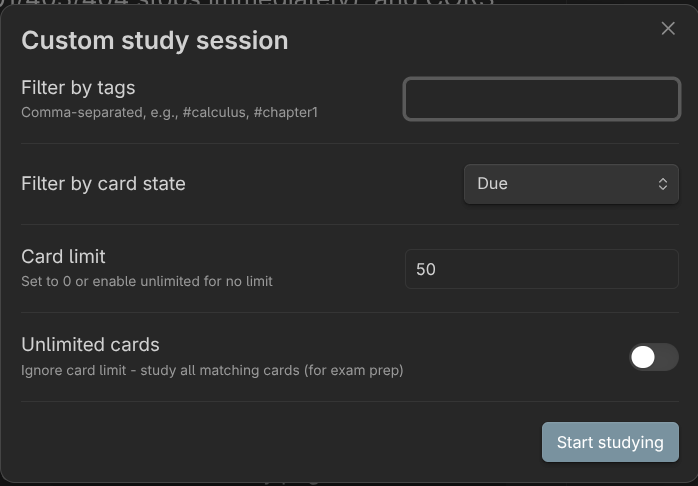

# Custom Study

Build a one-off Lemma review session from tags, card state and a card limit, including a cram mode that goes through every matching card for exam preparation.

## Open the form

1. Open the dashboard.
2. Click **Custom study**.

The **Custom study session** window opens with four fields.



## The fields

| Field | Default | What it does |
|---|---|---|
| **Filter by tags** | empty | Comma-separated tags, for example `#calculus, #chapter1`. Leave empty to include all decks |
| **Filter by card state** | Due | **Due**, **New**, **Learning** or **All cards (cram mode)** |
| **Card limit** | 50 | Maximum number of cards in the session. `0` means no limit |
| **Unlimited cards** | off | When on, ignores the card limit |

## Start a session

1. Enter tags if you want to narrow the cards.
2. Choose a card state.
3. Set the card limit, or turn on **Unlimited cards**.
4. Click **Start studying**.

If nothing matches, Lemma shows "No cards found matching your criteria." and keeps the window open. Otherwise the review window opens with the matching cards. See [Reviewing](reviewing.md).

## How tag filtering works

- Type each tag with a leading `#`, separated by commas. Spaces around commas are ignored and case does not matter.
- Tags are read from the deck note that holds the card, not from individual cards. Every card in a note shares that note's tags.
- A note matches if it has all the tags you list, so `#biology, #exam-prep` means both.
- Tags can be inline tags in the note body or entries in a frontmatter `tags` list. Frontmatter tags written as plain text instead of a list are not matched.
- Matching is exact: `#biology` does not match `#biology/cells`.

To use this, add extra tags to your deck notes, for example:

```yaml
---
tags: [flashcards, biology, chapter-1, exam-prep]
---
```

## How card state works

The state filter looks at each card's schedule:

- **Due**: cards that have been reviewed before and whose due time has passed.
- **New**: cards with no review history.
- **Learning**: cards that have been reviewed and are not due yet. In the code this covers every scheduled card whose due time is still in the future, not only cards in a learning step.
- **All cards (cram mode)**: every card, regardless of schedule.

## Things to know

- Custom study ignores the daily limits for new cards and reviews.
- It does not skip cards you already rated today.
- Cards are taken in the order Lemma holds them, up to the limit. They are not shuffled or sorted by due date.
- Ratings in custom study and cram sessions update card schedules like any other session.
- The session window title says "Reviewing" because it is not tied to one deck.

## Cram a single deck

For one deck you do not need the form. Click the lightning icon (**Cram all cards**) on the deck row. See [Reviewing](reviewing.md#start-a-review).
