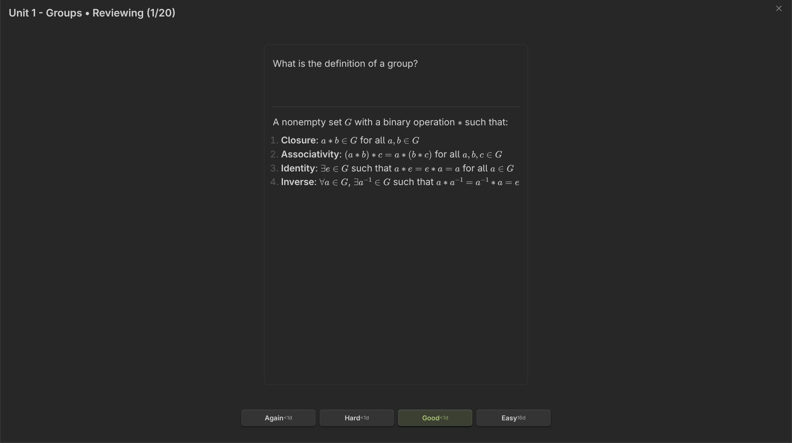

# Getting Started

Install Lemma in Obsidian, tag a note as a deck, write your first flashcard and finish a first review session with FSRS-5 scheduling in a few minutes.

## 1. Install Lemma

Lemma requires Obsidian 1.7.2 or later. The plugin id is `lemma-flashcards`.

### Install from Community plugins

1. In Obsidian, open **Settings > Community plugins**.
2. If Restricted mode is on, turn it off.
3. Click **Browse** and search for **Lemma**.
4. Click **Install**, then **Enable**.

### Install with BRAT

Lemma's release assets are published on GitHub, so you can also install a release with the BRAT community plugin. This guide does not cover BRAT itself; in BRAT, add the beta plugin repository `Fundaments-Work/Lemma`.

### Install manually

1. Download `main.js`, `manifest.json` and `styles.css` from the [latest release](https://github.com/Fundaments-Work/Lemma/releases/latest).
2. Create the folder `<your vault>/.obsidian/plugins/lemma-flashcards/`.
3. Copy the three files into it.
4. Restart Obsidian, then enable **Lemma** under **Settings > Community plugins**.

## 2. Open the dashboard

The dashboard lists your decks. Open it any of these ways:

- Click the Lemma icon in the ribbon (the left toolbar). On mobile it appears in the ribbon menu.
- Click **Lemma** in the status bar at the bottom of the window (desktop).
- Open the command palette and run **Open dashboard**.

The dashboard opens as a tab in the main workspace. If you have no decks yet it shows a "Ready to learn?" message with **Create new deck** and **Create flashcard** buttons.

## 3. Create a deck

A deck is a note that carries the deck tag, `#flashcards` by default.

1. On the dashboard, click **New deck**, or run the command **Create new deck**.
2. Type a deck title. Optionally type a folder; Lemma creates the folder if it does not exist.
3. Click **Create deck**.

Lemma creates the note with `flashcards` in its frontmatter tags and opens it. To turn an existing note into a deck instead, open it and run **Tag current note as flashcard deck**, or add the tag yourself:

```yaml
---
tags: [flashcards]
---
```

## 4. Write your first card

Add this to the deck note:

```markdown
---card--- ^my-first-card
What is spaced repetition?
---
A learning technique that schedules reviews at increasing intervals to maximize long-term retention.
```

You can also use the guided creator: run **Create card (guided modal)**, pick the deck note, choose a card type, fill in the fields and press **Insert card** (or `Ctrl+Enter`, `Cmd+Enter` on macOS). Lemma inserts the card with a generated block ID. See [Writing cards](writing-cards.md) for every format.

A deck only appears on the dashboard once it contains at least one card. Lemma re-reads a note shortly after you stop typing; if a new deck does not show up, click the refresh icon on the dashboard.

## 5. Run your first review

1. On the dashboard, expand the folder that holds your deck. Folders start collapsed.
2. Click the play icon on the deck row, or click **Study all due** to review across all decks.
3. Read the question and press `Space` or `Enter`, or click **Show answer**.
4. Rate your recall with `1` (Again), `2` (Hard), `3` (Good) or `4` (Easy). Each button shows the interval it would schedule.
5. Continue until the **Session complete!** screen appears, then click **Return to dashboard**.



Press `Esc` at any time to leave the session. Ratings you have already given are saved.

## Next steps

- Learn the card formats in [Writing cards](writing-cards.md).
- Understand the review window in [Reviewing](reviewing.md).
- Read [How scheduling works](how-scheduling-works.md) to see why a card comes back when it does.
