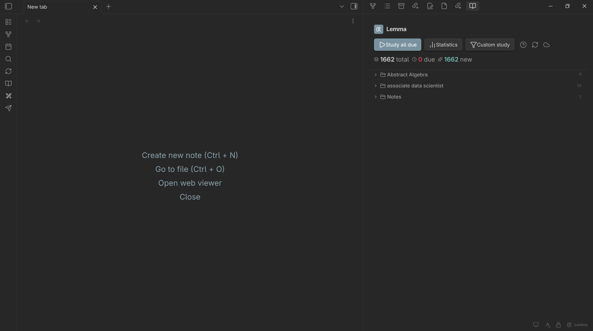

# Lemma User Guide

Lemma is an Obsidian plugin that turns tagged notes into flashcard decks and schedules reviews with FSRS-5 on desktop and mobile, with optional CouchDB sync.

Get Lemma from [lemma.fundaments.work](https://lemma.fundaments.work/) or the [GitHub releases](https://github.com/Fundaments-Work/Lemma/releases). [Getting started](getting-started.md) covers installation.

## What Lemma does

Lemma adds spaced repetition to the notes you already have. A note tagged `#flashcards` is a deck. Cards are plain Markdown written inside that note, so they stay readable, searchable and linkable like the rest of your vault. Lemma reads the cards, shows them in a review window, and schedules each card with FSRS-5 based on how you rate your recall.

- Seven card and study formats: basic, single-line, reversed, cloze, image occlusion, type-in and whole-note review.
- A dashboard with due and new counts per deck, grouped by folder.
- Custom study sessions filtered by tag, card state and size.
- A statistics window with retention, maturity, intervals, activity and per-deck charts.
- Review data stored on each device, with optional sync through your own CouchDB server.
- The same plugin on desktop and mobile (`isDesktopOnly` is `false` in the manifest).

Lemma makes no network requests unless you turn on sync. It has no telemetry or analytics.

## Where to start

1. If you are new, read [Getting started](getting-started.md) to install the plugin, write your first card and run your first review.
2. To learn every card format, read [Writing cards](writing-cards.md).
3. To understand when cards come back, read [How scheduling works](how-scheduling-works.md).

## Guide pages

- **[Getting started](getting-started.md)**
  Install Lemma from Community plugins, with BRAT or by hand, create a deck, write a first card and complete a first review.

- **[Writing cards](writing-cards.md)**
  The exact syntax for basic, single-line, reversed, cloze, image occlusion, type-in and whole-note cards, block IDs, and what you can put inside a card.

- **[Organizing decks](organizing-decks.md)**
  How tags make decks, how the dashboard groups them by folder, deck titles, the deck tag setting and how Lemma finds cards.

- **[Reviewing](reviewing.md)**
  The review window, the four ratings, interval hints, keyboard keys, swipe gestures, type-in answers, image cards, whole-note review and the card browser.

- **[How scheduling works](how-scheduling-works.md)**
  FSRS-5 in plain language, the four rating outcomes, daily limits, which cards enter a queue and what retention and maximum interval change.

- **[Custom study](custom-study.md)**
  Build a session from tags, card state and a card limit, and use cram mode.

- **[Statistics and dashboard](statistics-and-dashboard.md)**
  Read the dashboard counts, streak and XP, and every chart in the Statistics window.

- **[Settings](settings.md)**
  Every setting in the General, Sync, Advanced and About tabs, with defaults, and the FSRS weight optimizer.

- **[Mobile](mobile.md)**
  Using Lemma in Obsidian on a phone or tablet: dashboard, full-screen review and swipe ratings.

- **[Sync and data](sync-and-data.md)**
  What is stored where, how to connect your own CouchDB server, and what sync does and does not cover.

- **[Commands and shortcuts](commands-and-shortcuts.md)**
  Every command in the command palette, review keys, swipe gestures and editor menu actions.

- **[Backup and import](backup-and-import.md)**
  Export and merge review progress, undo a rating, and import cards from Anki text exports and CSV files.

- **[Migrating](migrating.md)**
  Move old `data.json` review data to the local database, and bring cards from other tools by converting text.

- **[Troubleshooting](troubleshooting.md)**
  Fix cards that do not appear, progress that looks wrong, sync errors, and known limitations.

## About this guide

This guide describes Lemma 1.2.0, which requires Obsidian 1.7.2 or later. Lemma is open source under the MIT license. Report problems or request features on [GitHub](https://github.com/Fundaments-Work/Lemma/issues).
