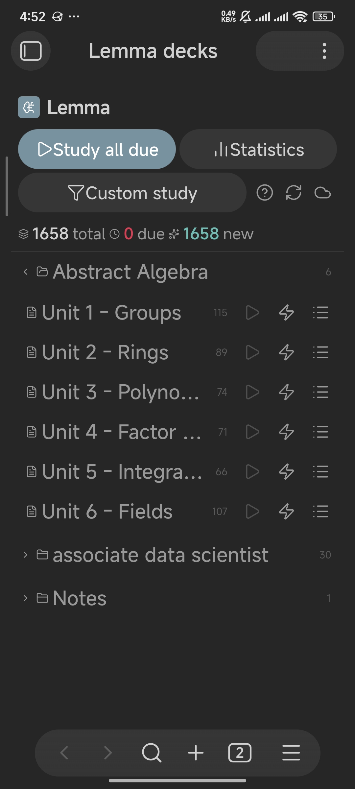
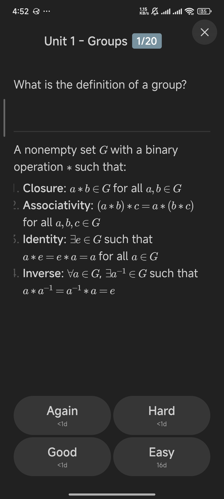
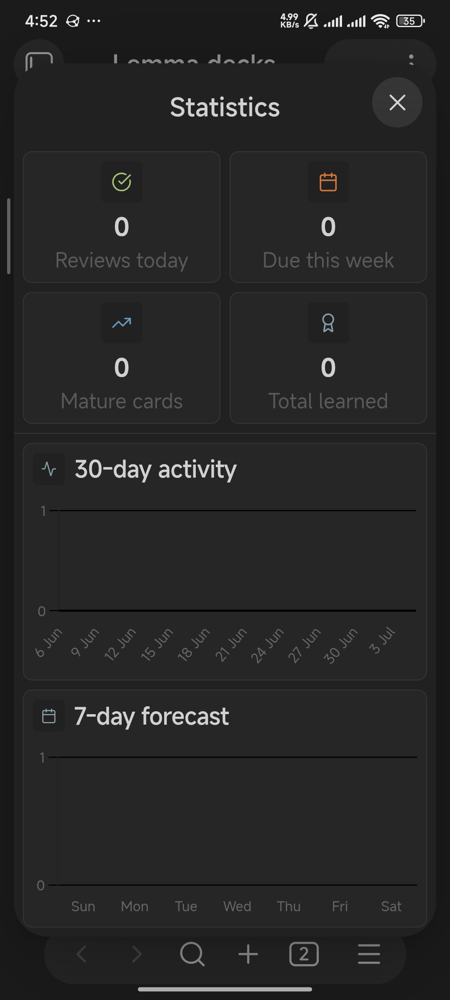

# Mobile

Lemma runs in Obsidian on phones and tablets with a full-screen review window, touch-friendly buttons and swipe ratings, using the same decks as desktop.

## Support

The plugin manifest sets `isDesktopOnly` to `false`, so Lemma installs and runs in Obsidian Mobile. Version 1.0.1 fixed start-up crashes on mobile, and the interface has been adapted for small screens. Lemma requires Obsidian 1.7.2 or later on mobile as well as desktop.

Install it the same way as on desktop: **Settings > Community plugins > Browse**, search for **Lemma**, then **Install** and **Enable**. See [Getting started](getting-started.md).

## Opening the dashboard

On mobile, use either of these:

- The Lemma icon in the ribbon menu. Open the ribbon from the Obsidian menu on your device.
- The command palette command **Open dashboard**.

The status bar button is a desktop feature, because Obsidian Mobile has no status bar.

The dashboard fills the main workspace. The header buttons wrap onto two rows, and deck rows show a due and new count with play, cram and browse icons. Folders start collapsed; tap a folder to expand it. Tap a deck's title to open its note.

## Reviewing on a phone

The review window uses the full screen. Card content runs edge to edge, the header and close button respect the device's safe areas (notch and bottom swipe bar), and the counter is a compact badge such as `1/20`.

1. Tap a deck's play icon or **Study all due**.
2. Tap **Show answer**.
3. Rate with the **Again**, **Hard**, **Good** or **Easy** buttons, or swipe the card. To take back a rating, tap the undo icon beside the close button.

Swipe directions after the answer is shown:

| Swipe | Rating |
|---|---|
| Left | Again |
| Down | Hard |
| Right | Good |
| Up | Easy |

Lemma tells swipes apart from scrolling a long card, so you can scroll a long answer vertically before you rate. A swipe must travel at least 60 pixels.

### Image and type-in cards on mobile

- **Image cards** swap question and answer in the same place. Tap the image to peek back and forth before rating. Long images are kept within the screen height.
- **Type-in cards** show a text box and a **Check** button. The on-screen keyboard opens for the text box.

## Creating cards on mobile

The guided creator works on touch screens. Tap **New card** on the dashboard, or run **Create card (guided modal)**, pick the deck note and card type, and tap **Insert card**. The keyboard shortcut `Ctrl+Enter` for insert is for hardware keyboards.

You can also write card syntax directly in the editor. The **Create cloze from selection** menu item appears in the editor's context menu when text is selected.

## Statistics on mobile

The Statistics window scrolls vertically and stacks its tiles two by two.

## Syncing review data between phone and computer

Review data is stored on each device. To keep a phone and a computer in step you need Lemma's CouchDB sync. Lemma has no other built-in way to share review data between devices. Your notes, and therefore your cards, move between devices through whatever you already use for your vault. See [Sync and data](sync-and-data.md).

On mobile, use an `https://` CouchDB address. Sync requires your server to accept requests from Obsidian, which on a CouchDB server means configuring CORS.
